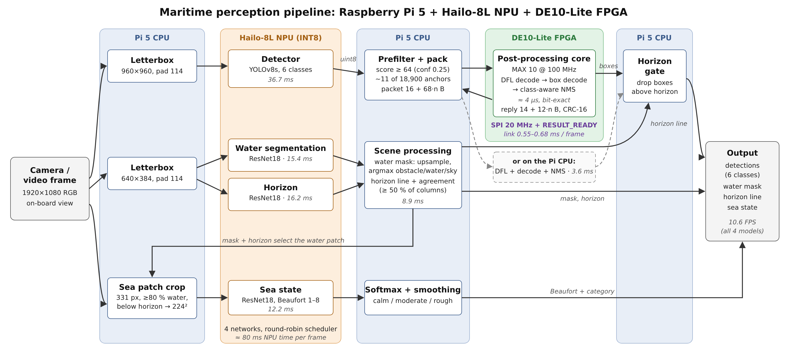
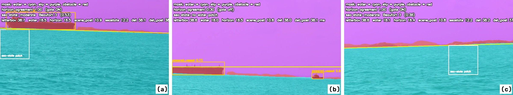
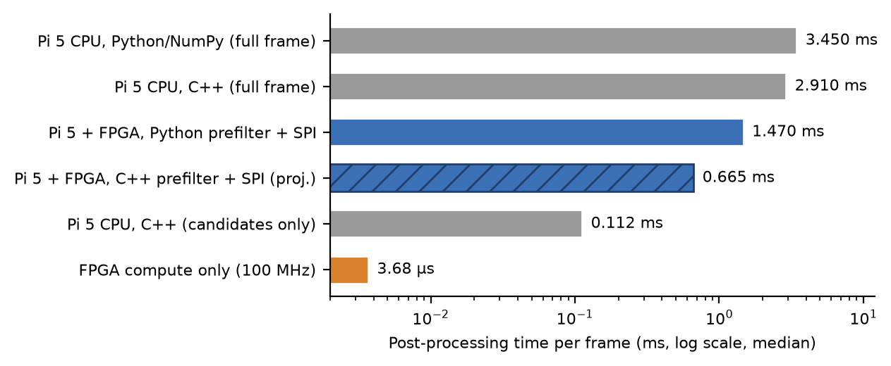

# Maritime Perception on the Edge: Raspberry Pi 5 + Hailo-8L + FPGA

Real-time maritime perception for small surface vessels on low-cost edge hardware.
Four INT8 neural networks run on one **Hailo-8L NPU** attached to a **Raspberry Pi 5**, and the object
detector's post-processing (DFL decoding, box decoding, NMS) can be offloaded to a **DE10-Lite FPGA**
(Intel MAX 10) over SPI, **bit-exact** with a software reference.

## What the system does

| Network | Task | Input | Output |
|---|---|---|---|
| **Detector** (YOLOv8s) | Find obstacles: powered vessel, sailboat, small craft, navigation marker, person in water, other obstacle | 960×960 | Boxes + classes |
| **Water segmentation** (ResNet18) | Label every pixel as water, sky, or obstacle | 640×384 | Mask |
| **Horizon** (ResNet18) | Locate the water-edge line | 640×384 | Line (left/right height) |
| **Sea state** (ResNet18) | Estimate the sea state from a water patch below the horizon | 224×224 | Beaufort 1–8 → calm / moderate / rough |

The horizon line feeds a **horizon gate** that drops detections above the water edge (birds, clouds,
objects on shore). The gate switches itself off when the water mask disagrees with the line, for example
when the camera rolls strongly or looks at the sky.

*Water cyan, sky purple, obstacles red, horizon yellow, sea-state patch white. (a) Ship detected with the
horizon gate active. (b) Strong camera roll: the horizon disagrees with the mask, so the gate turns off and
both vessels are kept. (c) Coastline segmented as obstacle.*

## Results

### Accuracy on held-out test sets (INT8 on the Hailo-8L vs. FP32)

| Network | Test set | Metric | FP32 | **INT8 (Hailo-8L)** |
|---|---|---|---|---|
| Detector | 537 images | mAP50 / mAP50-95 | 0.807 / 0.550 | **0.799 / 0.537** |
| Water segmentation | LaRS, 293 images | mean IoU | 0.955 | **0.955** |
| Horizon | LaRS, 232 images | mean error | 7.84 px | **9.36 px** |
| Sea state | UNIRI-SeaState, 2,022 patches | accuracy | 0.770 | **0.772** |

INT8 quantization keeps 99% of the detector's mAP50 and costs nothing measurable for water segmentation
and sea state. (Same post-processing and evaluation code for both columns.)

### Speed on the Raspberry Pi 5 + Hailo-8L

| Configuration | Time per frame | Frame rate |
|---|---|---|
| Detector only (letterbox + NPU + CPU post-processing) | 36.7 ms | 27.2 FPS |
| All four networks, every frame | 94.7 ms (≈ 80 ms on the NPU) | **10.6 FPS** |

### FPGA post-processing (DE10-Lite, MAX 10, 100 MHz)

The Pi keeps only the anchors that pass the score threshold (about 11 of 18,900 per frame after INT8
quantization) and sends them to the FPGA, which returns the final boxes.

| | Result |
|---|---|
| Resources | 29,081 LEs (58%), 387 kbit memory (23%), timing met at 100 MHz |
| Correctness | Bit-exact with the golden model on 30/30 live frames; 115,275 SPI transactions with 0 errors |
| FPGA compute | **3.68 µs** median per frame |
| SPI link (20 MHz) | 0.556 ms median per frame |
| In the full system | 1,200 frames on two videos, 0 link errors |

**Key finding:** the FPGA computes a frame in microseconds, but the SPI link (≈150× longer) sets the cost.
The FPGA path is 2.3× faster than the Python post-processing, while an optimized C++ path that also
thresholds first is faster still. In the full system the NPU, not post-processing, limits the frame rate.
An FPGA post-processor pays off when the host CPU is weak or busy, when deterministic and bit-exact
results are required, or with a faster link than SPI.

## Hardware

- Raspberry Pi 5 with the Hailo-8L AI HAT (PCIe)
- Terasic DE10-Lite (Intel MAX 10 10M50DAF484C7G), connected to the Pi's SPI0 with five wires plus a
  `RESULT_READY` line
- Training on the ASU Sol cluster (NVIDIA A100) and a laptop GPU

## Repository layout

| Folder | Contents |
|---|---|
| `scripts/` | Dataset building, auditing, and detector training |
| `configs/` | Dataset and training configurations |
| `scene/train/` | Training scripts for the water, horizon, and sea-state networks |
| `scene/deploy/` | ONNX export, Hailo compilation, Pi runner, and test-set evaluation for the scene networks |
| `hailo/` | Detector compilation for the Hailo-8L and the Raspberry Pi scripts (baseline, FPGA client, Mode B protocol, golden model) |
| `sol/` | Job scripts for the ASU Sol cluster |
| `tests/` | Tests |

## Workflow

1. **Build the datasets and train** the detector and the scene networks (`scripts/`, `scene/train/`, `sol/`).
2. **Export to ONNX and compile to HEF** with the Hailo Dataflow Compiler (`hailo/`, `scene/deploy/`).
3. **Run on the Pi**: detector baseline, the four-network system, and the test-set evaluation
   (`hailo/pi/`, `scene/deploy/`).
4. **FPGA post-processing**: the Pi client sends candidates to the DE10-Lite over SPI and checks every
   reply bit-exactly against the golden model (`hailo/pi/pi_mode_b_client.py`).

Exact commands are in `hailo/README.md`, `hailo/pi/README_MODE_B_CLIENT.md`, and `scene/deploy/README_SCENE_DEPLOY.md`.

## Datasets

Datasets are **not** included in this repository; download them from their sources and follow their licenses.

- **LaRS** maritime obstacle detection dataset (water and horizon labels): https://lojzezust.github.io/lars-dataset/
- **UNIRI-SeaState** (sea state, Beaufort 1–8): https://doi.org/10.5281/zenodo.19592919
- **Singapore Maritime Dataset** (demonstration videos): https://sites.google.com/site/dilipprasad/home/singapore-maritime-dataset
- The six-class detector dataset was assembled from public maritime datasets (see `configs/`).

## Team

- Saravanan Murugan
- Jia Wei
- Prince Coffie

School of Electrical, Computer and Energy Engineering, Arizona State University, Tempe, AZ, USA

## License

The code is released under the [MIT License](LICENSE). Datasets and trained models are subject to the licenses of the datasets they come from.
